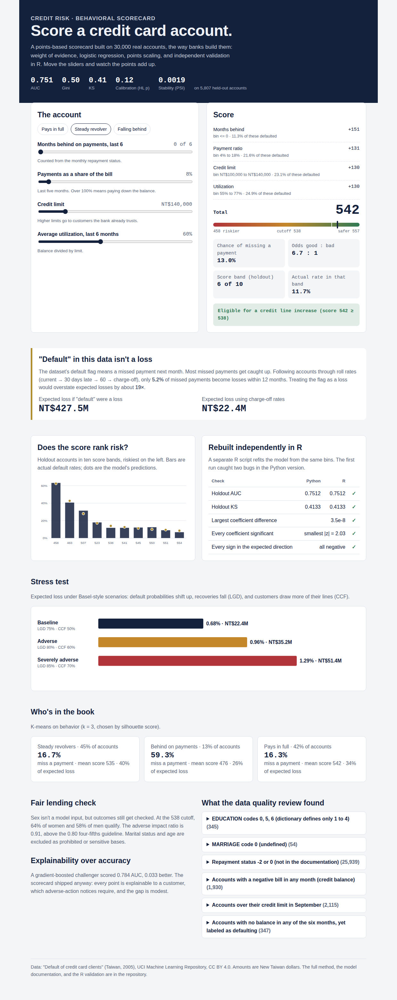
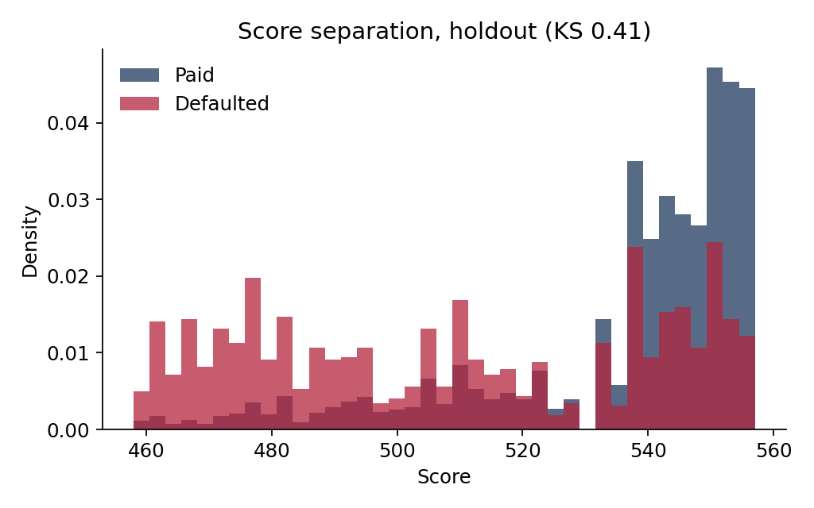
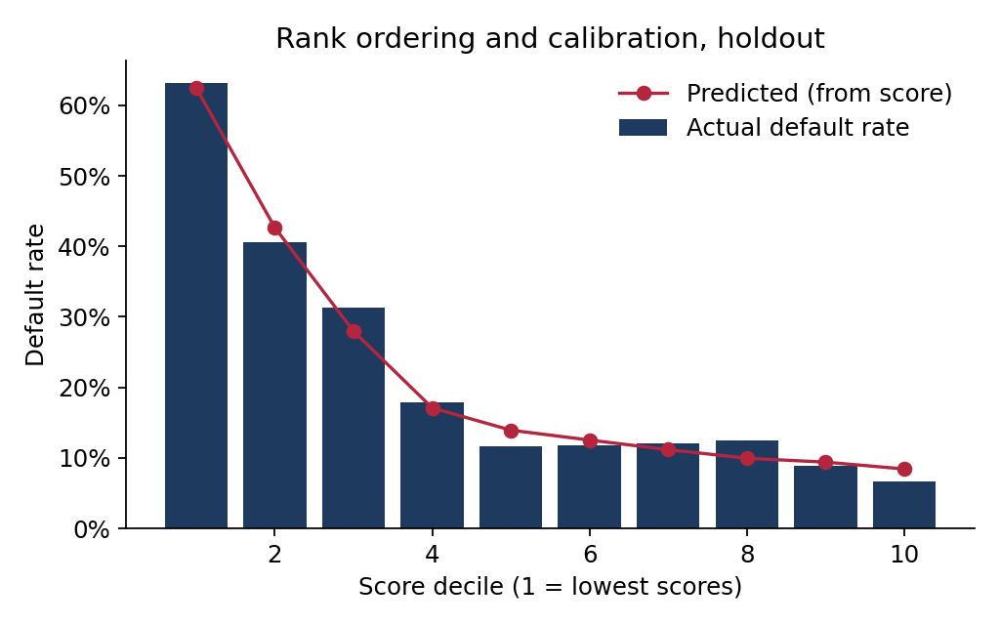
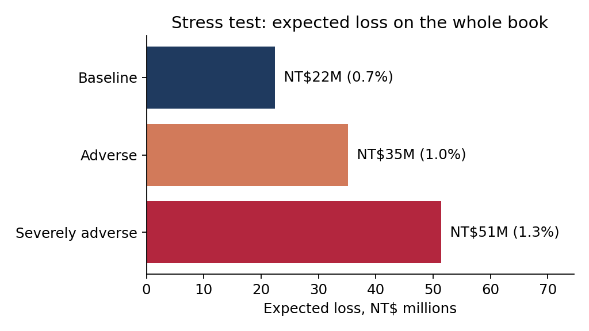

# Credit Risk Scorecard

**Live demo:** https://credit-risk-scorecard.vercel.app (score an account, see the points add up, and explore validation, stress tests and segments)



A behavioral credit scorecard for a credit card book, built the way a bank's risk team builds one: data quality checks, monotonic weight-of-evidence binning, a points-based logistic scorecard, validation, an independent re-implementation in R, fairness testing, roll-rate loss forecasting in SQL, a Basel-style stress test, and customer segmentation. The data is 30,000 real accounts.



## Results at a glance

| | |
|---|---|
| Holdout Gini / KS | 0.502 / 0.413, stable across development, validation and holdout |
| Calibration | Mean predicted 21.6% against 21.7% actual; Hosmer-Lemeshow p = 0.12 |
| Rank ordering | No statistically significant reversal across score deciles |
| Stability | PSI 0.0019 between development and holdout |
| What transparency costs | A gradient-boosting challenger scores 0.033 more AUC |
| Fairness | Adverse impact ratio 0.91 by sex for line-increase eligibility, above the 0.80 four-fifths line |
| Independent validation | R's `glm()` reproduces the coefficients to 4e-08, and AUC and KS exactly |
| Baseline 12-month expected loss | NT$22.4M (0.68% of exposure), rising to NT$51.4M (1.29%) under severe stress |

## Data

The [Default of Credit Card Clients](https://doi.org/10.24432/C55S3H) data from a Taiwanese bank, April to September 2005 (Yeh & Lien, 2009; UCI, CC BY 4.0). It has 30,000 accounts with credit limits, six months of bills, payments and repayment status, and whether the account missed its October payment. Two independent copies, the original UCI spreadsheet and a version distributed in an R package, were compared cell by cell before anything else, and they match.

## What the data quality checks found

| Check | Found | Treatment |
|---|---|---|
| Rows and unique IDs | 30,000 of 30,000 | One row per account, no duplicates. |
| EDUCATION codes 0, 5, 6 (dictionary defines only 1 to 4) | 345 of 30,000 | Grouped with 4 (other). Education isn't a scorecard input, so this only affects reporting. |
| MARRIAGE code 0 (undefined) | 54 of 30,000 | Kept as unknown. Marital status is a prohibited basis under ECOA and is excluded from the model. |
| Repayment status -2 or 0 (not in the documentation) | 25,939 of 30,000 | Read as -2 = no balance to pay, -1 = paid in full, 0 = revolving (minimum paid). These are ordered and binned, not treated as delinquency. |
| Accounts with a negative bill in any month (credit balance) | 1,930 of 30,000 | Kept. Utilization is floored at zero. |
| Accounts over their credit limit in September | 2,115 of 30,000 | Kept. Utilization is capped at 150% so a few extreme values don't drive bins. |
| Missing values | 0 of 750,000 | None found. |
| Accounts with no balance in any of the six months, yet labeled as defaulting | 347 of 966 | These 966 inactive accounts default at 36%, above the book's average, which is implausible for accounts that owe nothing. They're excluded from development as indeterminate, the usual practice for behavior scorecards, and flagged for the data owner. |

Two findings changed the whole analysis.

**Status codes aren't consistent across months.** Code 1 ("one month late") appears 3,688 times in September, 28 times in August, and almost never before that. Earlier months jump from 0 to 2. Roll rates computed on raw codes made bucket 1 look like a trap nobody ever left. Codes 1 and 2 are merged into one "1-2 months past due" bucket in every month.

**"Default" in this data means missing a payment, not a loss.** 22.1% of accounts "default" next month. Treating that as the probability of loss, the way many projects with this data do, implies a 13.0% loss rate, which is absurd for a card book. The roll-rate chain shows that only 5.2% of customers who miss a payment reach charge-off within 12 months. The expected-loss and stress figures multiply the scorecard's probability by that bridge. After that, the scorecard-based loss (NT$22.4M) and the independent roll-rate forecast (NT$31.7M) agree to within a factor of 1.4, instead of 60.

## The scorecard

Sex, marital status and age are left out of the model. The first two are prohibited bases under the Equal Credit Opportunity Act, and age can only be used under narrow conditions. Sex is kept aside for fairness testing.

Eleven behavioral features were built from the statements: delinquency counts, utilization, payment ratios, and limit. Each was binned so its default rate moves in one direction only, then screened:

| Feature | Decision | Why |
|---|---|---|
| Months delinquent, last 6 | kept | IV 0.898 |
| Current repayment status | dropped | correlation 0.75 with months_delinquent_6m, which has higher IV |
| Worst status, last 6 | dropped | correlation 0.92 with months_delinquent_6m, which has higher IV |
| Status last month | dropped | correlation 0.78 with months_delinquent_6m, which has higher IV |
| Months with no payment, last 5 | dropped | correlation 0.73 with months_delinquent_6m, which has higher IV |
| Last payment / amount owed | kept | IV 0.273 |
| Credit limit (NT$) | kept | IV 0.213 |
| Average payment ratio, last 5 | kept | IV 0.195 |
| Average utilization, last 6 months | kept | IV 0.119 |
| Utilization now | dropped | correlation 0.86 with avg_utilization_6m, which has higher IV |
| Utilization change over 6 months | kept | IV 0.064 |
| Utilization change over 6 months | dropped | coefficient had the wrong sign once others were in |
| Average payment ratio, last 5 | dropped | not statistically significant once others were in (|z| = 0.94) |

The final model is a logistic regression on weight of evidence, scaled so 600 points means 50:1 odds and every 20 points doubles them. An account's score is the sum of its points:

**Months delinquent, last 6**

| Range | Points | Accounts | Default rate |
|---|---|---|---|
| <= 0 | 151 | 11,672 | 11.3% |
| 0 to 1 | 122 | 2,309 | 27.7% |
| 1 to 2 | 108 | 1,152 | 39.8% |
| 2 to 4 | 93 | 1,257 | 53.9% |
| > 4 | 80 | 1,030 | 66.2% |

**Last payment / amount owed**

| Range | Points | Accounts | Default rate |
|---|---|---|---|
| <= 0 | 128 | 1,344 | 52.5% |
| 0 to 0.0368255 | 131 | 1,269 | 22.8% |
| 0.0368255 to 0.181922 | 131 | 7,839 | 21.6% |
| 0.181922 to 0.345338 | 131 | 871 | 20.1% |
| 0.345338 to 1 | 132 | 4,471 | 16.5% |
| > 1 | 133 | 1,626 | 10.6% |

**Credit limit (NT$)**

| Range | Points | Accounts | Default rate |
|---|---|---|---|
| <= 20000 | 122 | 1,481 | 36.1% |
| 20000 to 30000 | 123 | 966 | 35.1% |
| 30000 to 70000 | 127 | 3,042 | 27.4% |
| 70000 to 100000 | 129 | 1,894 | 24.6% |
| 100000 to 140000 | 130 | 1,634 | 23.1% |
| 140000 to 240000 | 135 | 4,343 | 16.2% |
| 240000 to 300000 | 137 | 1,465 | 15.0% |
| > 300000 | 140 | 2,595 | 11.6% |

**Average utilization, last 6 months**

| Range | Points | Accounts | Default rate |
|---|---|---|---|
| <= 0.234151 | 133 | 7,839 | 16.5% |
| 0.234151 to 0.319245 | 132 | 871 | 17.2% |
| 0.319245 to 0.397494 | 131 | 871 | 20.8% |
| 0.397494 to 0.476368 | 131 | 871 | 22.3% |
| 0.476368 to 0.553132 | 130 | 871 | 23.6% |
| 0.553132 to 0.76828 | 130 | 2,613 | 24.9% |
| 0.76828 to 0.832628 | 129 | 871 | 28.5% |
| > 0.832628 | 128 | 2,613 | 32.7% |

## Validation

| Sample | Accounts | Default rate | AUC | Gini | KS |
|---|---|---|---|---|---|
| Development | 17,420 | 21.7% | 0.755 | 0.510 | 0.416 |
| Validation | 5,807 | 21.7% | 0.754 | 0.509 | 0.426 |
| Holdout | 5,807 | 21.7% | 0.751 | 0.502 | 0.413 |



| Score decile | Score range | Actual default rate | Predicted |
|---|---|---|---|
| 1 | 458 to 483 | 63.2% | 62.5% |
| 2 | 483 to 507 | 40.6% | 42.7% |
| 3 | 507 to 523 | 31.4% | 28.0% |
| 4 | 523 to 538 | 17.9% | 17.1% |
| 5 | 538 to 541 | 11.7% | 13.9% |
| 6 | 541 to 545 | 11.7% | 12.5% |
| 7 | 545 to 550 | 12.0% | 11.2% |
| 8 | 550 to 551 | 12.4% | 10.0% |
| 9 | 551 to 554 | 9.0% | 9.4% |
| 10 | 554 to 557 | 6.7% | 8.4% |

The middle deciles are crowded: a points scorecard has a limited number of distinct scores, so many accounts tie. The small reversals there are tested with a two-proportion z-test rather than eyeballed, and none is significant (largest z = 0.19).

**Independent validation in R.** `r/validate_scorecard.R` refits the model with base R's `glm()` and recomputes AUC (by the Mann-Whitney formula) and KS from the raw holdout scores, using its own code. It also reports each coefficient's significance, which scikit-learn doesn't. It caught two real problems on the way:

- A feature whose coefficient wasn't distinguishable from zero. The Python pipeline now computes Wald z-statistics and drops such features.
- A KS calculation that split tied scores arbitrarily, overstating KS slightly. It now evaluates at each distinct score.

All five checks now pass: coefficients match to 4e-08, and AUC and KS match exactly.

**The challenger.** Gradient boosting on the same features reaches AUC 0.784, against the scorecard's 0.751. That 0.033 is the price of a model whose every decision can be read off a table, explained to a customer as an adverse-action reason, and reviewed by a regulator. For a decision model, it's usually worth paying. The challenger stays useful as a monitoring benchmark: if the gap widens, something in the data has changed.

## Fairness

The scorecard decides eligibility for a credit line increase: the top 60% of scores qualify. On the holdout set, 63.5% of women and 57.8% of men qualify, an adverse impact ratio of 0.91 (above the 0.80 four-fifths line). Within each score band, women default 1.2 points less than men on average. So the score is, if anything, slightly conservative for women, which is worth monitoring but isn't adverse treatment.

## Loss forecasting with roll rates (SQL)

`sql/roll_rates.sql` reshapes six months of status into long form in DuckDB, buckets it, and counts how balances move between buckets from one month to the next. These are dollar-weighted, because losses are dollars:

| From \ to | current | 1-2 | 3-4 | 5+ |
|---|---|---|---|---|
| current | 94.9% | 5.1% | 0.0% | 0.0% |
| 1-2 | 19.4% | 75.6% | 5.0% | 0.0% |
| 3-4 | 6.4% | 35.0% | 46.9% | 11.7% |
| 5+ | 1.8% | 9.7% | 11.4% | 77.1% |

Treating 5+ as charge-off and stepping the chain forward 12 months gives each bucket's chance of reaching charge-off:

| Bucket today | Accounts | Balance | Reaches charge-off within 12 months | Expected loss (LGD 75%) |
|---|---|---|---|---|
| current | 23,182 | NT$1,239.7M | 1.36% | NT$12.6M |
| 1-2 | 6,355 | NT$273.7M | 5.24% | NT$10.8M |
| 3-4 | 398 | NT$17.4M | 25.19% | NT$3.3M |
| 5+ | 65 | NT$6.6M | 100.00% | NT$5.0M |

## Stress test

Each account's probability is stressed with the Vasicek single-factor model, the one behind Basel capital rules, using Basel's 4% asset correlation for card portfolios. Loss given default and drawdown of unused limits rise with the scenario:

| Scenario | Story | Mean P(miss) | Mean P(charge-off) | LGD | Expected loss | Loss rate |
|---|---|---|---|---|---|---|
| Baseline | Today's predicted default rates. | 21.6% | 1.13% | 75% | NT$22.4M | 0.68% |
| Adverse | A downturn severe enough to happen about once a decade. | 28.2% | 1.48% | 80% | NT$35.2M | 0.96% |
| Severely adverse | About a 1-in-100-year shock: unemployment spikes, recoveries fall, customers draw down lines. | 34.6% | 1.82% | 85% | NT$51.4M | 1.29% |



Losses roughly double in the severe scenario. The biggest lever after PD is the assumed drawdown of unused limits, which the bank should estimate from its own history rather than take from here.

## Segments

K-means on utilization, payment behavior, delinquency and limit, with k chosen by silhouette score (k = 3):

| Segment | Share of book | Utilization | Payment ratio | Months delinquent | Default rate | Share of expected loss |
|---|---|---|---|---|---|---|
| Steady revolvers | 45% | 59% | 11% | 0.3 | 16.7% | 40% |
| Behind on payments | 13% | 63% | 9% | 4.3 | 59.3% | 26% |
| Pays in full | 42% | 5% | 85% | 0.3 | 16.3% | 34% |

One result is worth questioning rather than reporting: customers who pay in full show a 16.3% "default" rate, close to revolvers'. Some of that is the same labeling problem as the inactive accounts. Some is that their large unused limits dominate their exposure. A real bank would estimate drawdown by segment before acting on the loss shares.

## Running it

```bash
pip install -r requirements.txt
python -m src.roll                   # roll rates in SQL; writes the missed-payment to charge-off bridge
python -m src.build                  # scorecard, validation, fairness, stress, segments, Tableau extracts
Rscript r/validate_scorecard.R       # independent validation; exits non-zero if anything disagrees
python -m src.report                 # this README and the model documentation
pytest -q
```

## For Tableau

`results/tableau/` holds tidy extracts: scored accounts, the scorecard, deciles, segments, and stress results. `docs/tableau.md` specifies the dashboards they're built for. I didn't build the workbook itself in this environment. Publishing it to Tableau Public and linking it here is the next step.

## Documentation

`docs/model_documentation.md` is a model development document in the format a model risk team reviews: purpose, data, exclusions, methodology, performance, limitations, and a monitoring plan.
